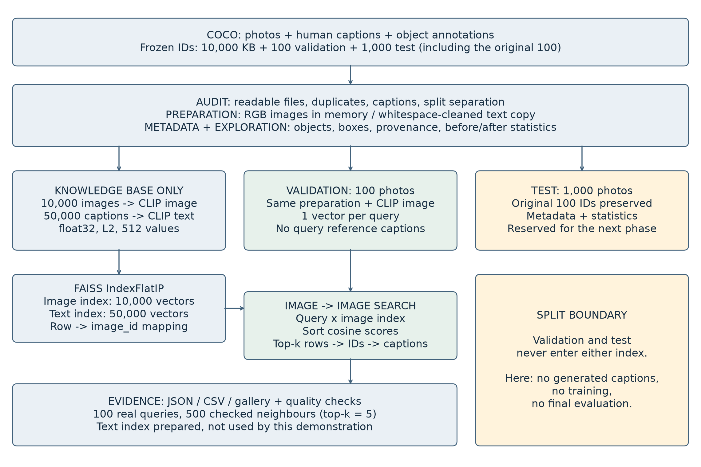
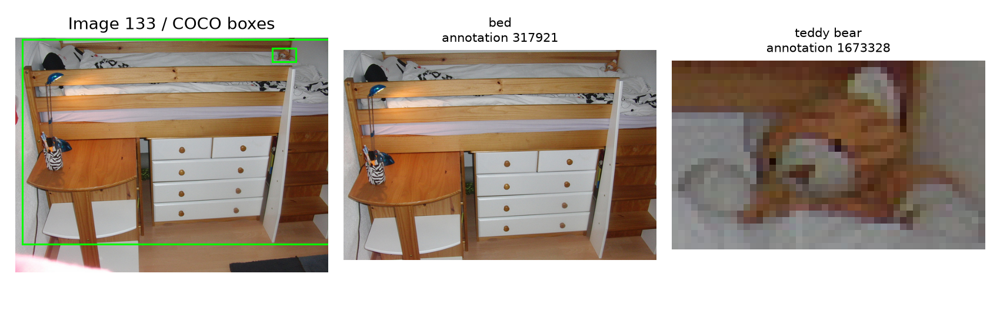
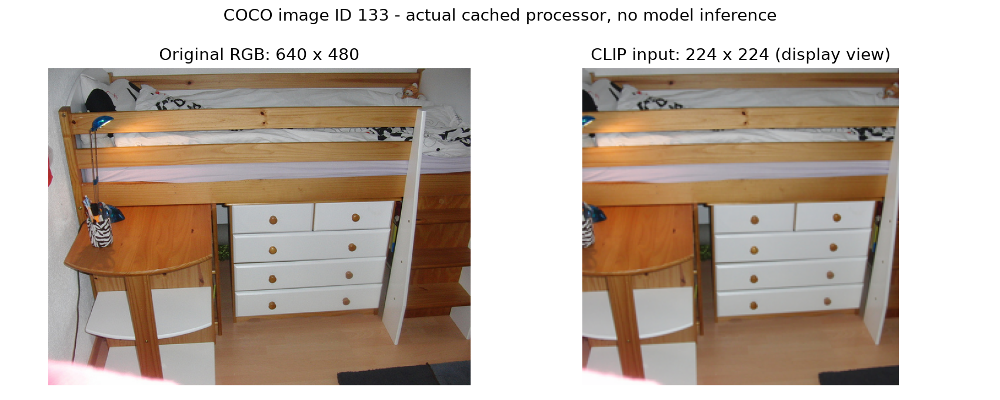
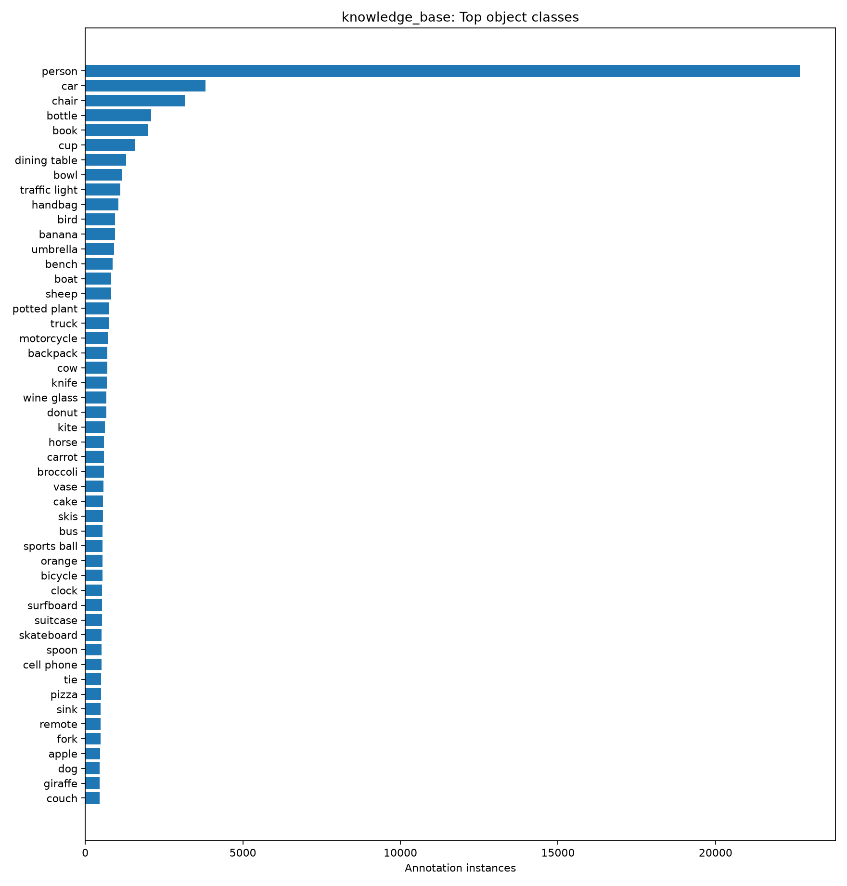
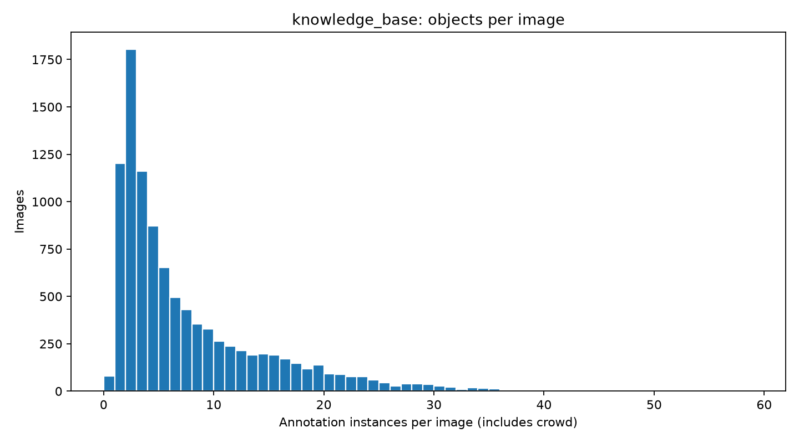
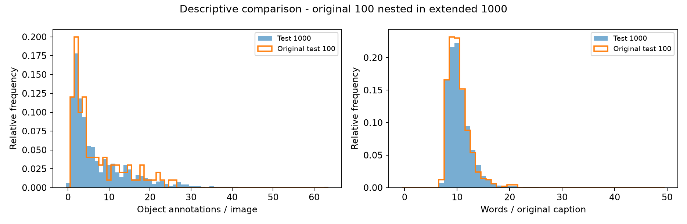
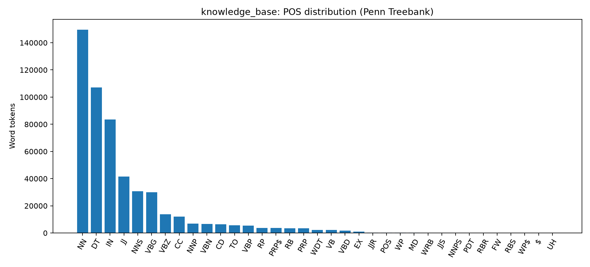
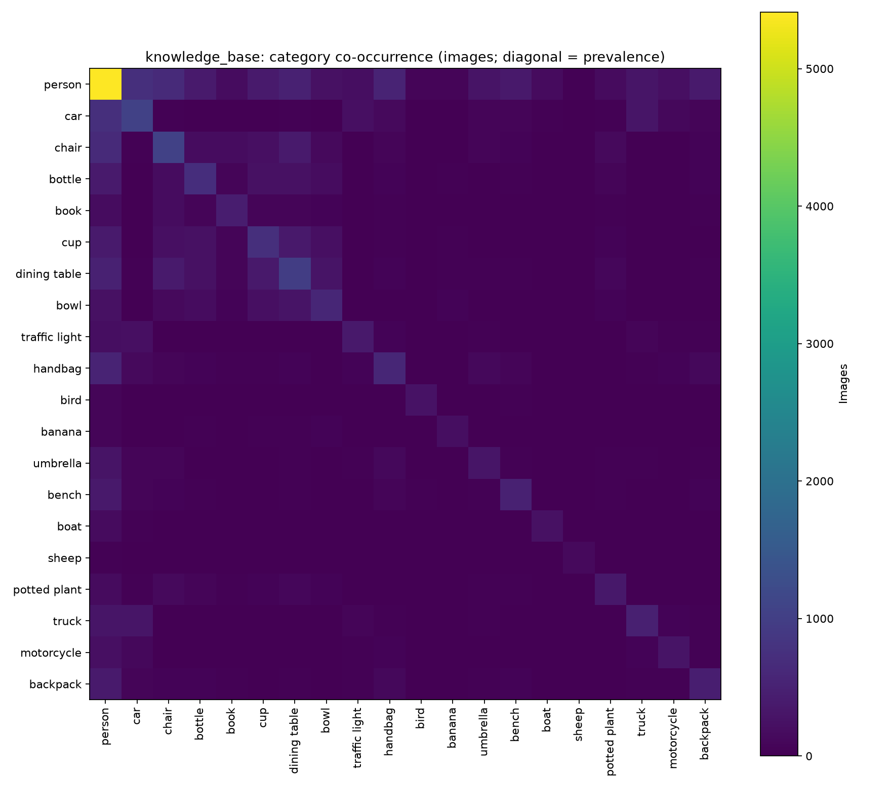
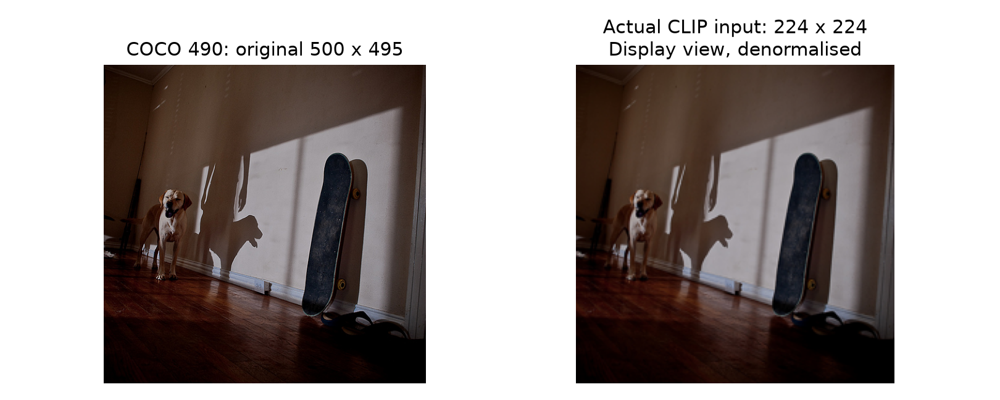
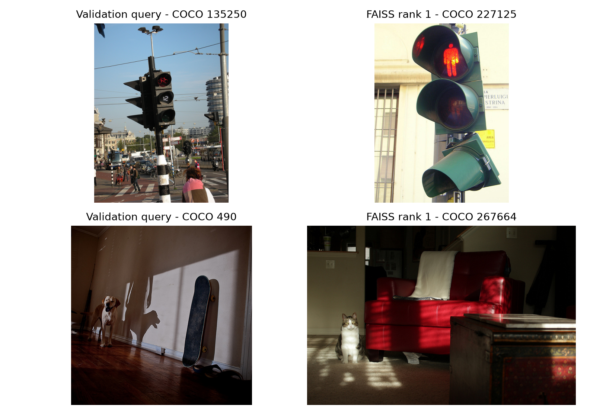

# Data exploration and pre-processing

People's Democratic Republic of Algeria
Ministry of Higher Education and Scientific Research

University of Algiers 1 Benyoucef Benkhedda
Faculty of Sciences - Department of Computer Science


Master 1 - Intelligent Computer Systems Engineering
Module: Introduction to Image Processing

A comparative study of RAG techniques
for generating image captions

Phase-1 report

Data exploration and pre-processing

Prepared by

Hamou Yasmine
Ouziala Ali
Lounis Aya

Academic year 2026-2027
Phase deadline: 4 November 2026
Updated version: 7 November 2026

## 1. Purpose and reading guide

A caption is a sentence describing an image. Later, RAG will retrieve similar examples to help a model write that sentence. First, reliable data are needed: a readable image, its five reference sentences, associated information and a numerical representation that can be searched.

Training refers here to the train2017 source used to build the knowledge base. CLIP is used with pretrained weights; it was neither trained nor fine-tuned on this subset.

| Step | Question answered | Page |
|---|---|---|
| Overview | What path does an image follow? | 3 |
| Choices and data | Why these tools and splits? | 4-5 |
| Audit and preparation | What is checked and transformed? | 6-9 |
| Exploration | What do the statistics show? | 10-13 |
| CLIP / FAISS | How does retrieval work? | 14-15 |
| Example and discussion | Trace a photograph and understand errors | 16-17 |
| Reproduction | Which commands should be run? | 18-19 |
| Status and limitations | What is ready and what needs approval | 20 |

### How to read the results

Numbers come from the project's JSON and CSV files. Figures use COCO images and saved statistics. Each step explains its input, method and output. Technical terms are defined when first used.

The code is organised into modules matching these steps. python -m src.cli runs them from the terminal. Notebooks call the same modules rather than implementing a second computation method. Output files allow results to be checked without repeating the entire computation.

## 2. Overview: from file to retrieval

The project prepares a library of examples. A query photograph is compared with that library: similar images are found, then the sentences already attached to those images are retrieved. In this phase the program does not write a new sentence.



### Three questions for reading the diagram

1. What is prepared? COCO files, their objects and their five human captions. The audit checks the data before statistics and vectors are computed. Originals are retained.

2. What is searched? Only the 10,000 KB images. CLIP translates each image into 512 numbers; FAISS compares those number lists. A mapping file then leads back to the correct photograph and its captions.

3. How is it checked? The 100 validation images act as queries without their captions. The 1,000 test images are prepared and described, but their final evaluation belongs to the next phase.

## 3. Why these choices?

We chose a pipeline that can be checked on this PC. Each choice serves a specific need; none of the checks here proves this is the best possible configuration.

| Choice | Reason | Limitation |
|---|---|---|
| Fixed IDs, seed 42 | Recover exactly the same images; preserve the original test100. | A local sample cannot replace the teacher's common list. |
| Objects from COCO annotations | Link each category and box to its image with a known source. | This is not a detector run on pixels. The invalid box is flagged. |
| Light caption cleaning | Fix whitespace without changing meaning; retain caption_raw for checking. | Possible human language errors are not corrected. |
| Official CLIP processor | Give the model its expected input: RGB, 224 x 224 and matching normalisation. | Centre cropping can remove a peripheral object. |
| Frozen pretrained CLIP | Represent images and text without training a model on this small set. | Global similarity does not guarantee matching objects or actions. |
| L2 + IndexFlatIP | Unit norm makes inner product equal cosine. Exhaustive comparison of 10,000 images. | Easy to check, but cost grows with KB size. |
| JSONL + image_rows.json | Separate vectors and text while preserving an explicit image_id link. | A row mismatch would retrieve wrong captions; checks validate this link. |

Why not search using validation sentences? That would supply a description of the answer. The demonstration starts only from query pixels. The text index is prepared for later work and is not used by this image-to-image check.

## 4. COCO data and split separation

COCO provides photographs and JSON annotation files. Caption files link sentences to images. Instance files link object categories and bounding boxes to images. The official directory name is val2017, not val17.

| Use | Source | Present | Target |
|---|---|---|---|
| Knowledge base | train2017 | 10 000 | 10 000 |
| Separate validation | train2017 | 100 | 100 |
| Preserved initial test | val2017 | 100 | 100 |
| Extended test | val2017 | 1 000 | 1 000 |

10,000 + 100 = 10,100 distinct train2017 images. The 1,000 test images come from val2017, giving 11,100 unique selected images in total. The original 100 test images are included within the 1,000, not counted again.

### Why separate these uses?

The knowledge base contains examples FAISS may retrieve. Validation supports checks and later parameter choices. Test data must remain reserved for evaluation. Their reference captions must not construct a query or enter the knowledge base.

### How images were selected

Candidates must have matching instance-image information and exactly five captions. Eligibility exclusions are recorded: 315 train2017 IDs and 13 val2017 IDs. These are not corrupt-image counts. Scenes are grouped by annotation count: simple (0-3), medium (4-7), complex (8 or more). Quotas are proportional, with largest-remainder rounding. Sampling uses seed 42.

extend-test preserved the exact KB and validation IDs, retained the original 100 test IDs and added a seed-42 stratified sample of 900 other eligible val2017 IDs. Lists are frozen and SHA256-checked. The previous release is archived under reports/releases/. As the class-wide ID list was not supplied, this local test must not be presented as the official common test.

## 5. Downloading and auditing the data

Downloads use official COCO S3 storage over HTTPS. Only photographs listed in the frozen splits are downloaded. The annotation archive provides captions_train2017.json, captions_val2017.json, instances_train2017.json and instances_val2017.json. Originals stay in data/raw/.

Before preparation, the program checks each file's existence, full Pillow decoding, dimensions, five captions and associated IDs. File and RGB-pixel fingerprints identify exact copies. It also checks intersections between image lists and between caption IDs.

| Check | Observed result |
|---|---|
| Expected / present / readable images | 11 100 / 11 100 / 11 100 |
| Missing or unreadable images | 0 |
| Captions per image | 5 |
| Shared image IDs between splits | 0 |
| Exact file or pixel copies | 0 |
| Documented degenerate box | 1 |
| Shared normalised caption strings | 87 |

### One anomaly retained and explained

Annotation 918 of image 200365 contains box [296.65, 388.33, 1.03, 0.0], with zero height. The initial audit stopped. The image, captions and object category were retained, with bbox_valid=false. This box is excluded from geometry and rectangle drawing. Official COCO files were not manually changed.

The extended audit identifies 87 normalised caption strings shared across splits. They belong to distinct images and annotations and are documented without automatic deletion. Exact file and pixel duplicates are checked; perceptual near-duplicates remain a limitation. Evidence is in reports/audit.json and reports/tables/.

## 6. Linking images to their metadata

Metadata are information associated with an image. Each JSONL row represents one image: image_id, filename, split, dimensions, fingerprint, five captions, objects, categories and boxes. JSONL simply means one JSON object per line. This keeps an image and its information linked.

| Information | Actual source | Interpretation |
|---|---|---|
| Objects and boxes | coco_annotation | Human COCO annotations |
| Colours, shapes, context | caption_heuristic | Words found in captions |
| Spatial relations | bbox_heuristic | Geometry computed from boxes |



### Visual detection and confidence: actual implementation

No YOLO, DETR or other detector was run. The teacher's recommended visual extraction remains a possible improvement. CLIP provides a global vector here, not a list of objects with boxes and confidence scores. Current object statistics describe COCO annotations.

Each human caption now carries source=coco_human_reference and confidence=1. The reference retention threshold is also 1 in the configuration and metadata policy: all five human references are retained. This is a provenance convention, not a calibrated probability. It is not assigned to lexicon-derived attributes or inferred relations. No visual detector threshold applies because no detector was run.

## 7. Image pre-processing

Pre-processing prepares CLIP's expected input. The JPEG is opened, EXIF orientation is corrected when needed, and the image is converted to RGB. RGB retains the three colour channels expected by the encoder. Colour information is preserved when representing photograph content.

The model's official processor resizes the shorter side to 224 pixels while preserving aspect ratio, then takes a central 224 x 224 crop. It rescales values and normalises each channel using the model parameters. Cropping may remove peripheral objects; this is a limitation.



```powershell
mean = [0.48145466, 0.45782750, 0.40821073]
std  = [0.26862954, 0.26130258, 0.27577711]
normalised_channel = (channel / 255 - mean) / std
```

The illustrated check produced a finite tensor of shape (1, 3, 224, 224). The JPEG fingerprint is unchanged. Transformed images are used in memory; no second JPEG collection is written into data/processed/. The example and its parameters are recorded in reports/phase1_processor_example.json.

## 8. Captions and before/after comparison

Original captions are human references. caption_raw preserves their exact text, including spaces. A separate caption_clean field is used for indexing: repeated, leading and trailing whitespace is normalised. Case and punctuation are preserved in the current configuration. There is no translation, rewriting or stop-word removal.

| Split | Images before/after | Captions | Changed clean fields |
|---|---|---|---|
| knowledge_base | 10000 / 10000 | 50000 | 7743 |
| validation | 100 / 100 | 500 | 72 |
| test | 1000 / 1000 | 5000 | 745 |
| test_100 | 100 / 100 | 500 | 88 |

In the knowledge base, 7743 of 50,000 captions have a clean field different from the raw text. Character count changes from 2620933 to 2612839. All 50,000 raw references remain unchanged. These values were recounted from actual metadata during the review.

```powershell
caption_id: 424250
raw:   'Bunk bed with a narrow shelf sitting underneath it. '
clean: 'Bunk bed with a narrow shelf sitting underneath it.'
```

### What this comparison measures

Before/after refers here to retained counts, text cleaning, image formats and exclusion of the invalid box from geometry. All 72,507 knowledge-base object annotations are retained; 72,506 boxes are usable for relations. Category frequencies therefore remain unchanged. No generation-score improvement is claimed.

The following language statistics use raw text. NLTK's Treebank tokenizer splits sentences; only tokens containing a letter count as words. They are lowercased for vocabulary counting. For part-of-speech (POS) tagging, the model receives the full original-case sequence. Word counts are not CLIP sub-token counts.

## 9. Exploration: object frequencies

The knowledge base contains 72,507 object annotations. The chart counts annotation instances, not images containing each category. An image with several people contributes several entries to person. Crowd annotations remain counted as annotation entries.



person leads with 22,670 annotations, followed by car (3,815) and chair (3,151). This imbalance describes the selected subset; it does not by itself establish a future model's quality.

## 10. Exploration: scene complexity

| Measure | KB | Validation | Test 100 | Test 1000 |
|---|---|---|---|---|
| Annotations/image: mean | 7.2507 | 7.3400 | 7.0500 | 7.3880 |
| Median | 4.0 | 4.5 | 4.0 | 4.0 |
| Standard deviation | 7.3305 | 8.3848 | 6.4628 | 7.4213 |
| Minimum - maximum | 0 - 59 | 0 - 58 | 1 - 26 | 0 - 63 |





The KB contains 4,247 simple, 2,449 medium and 3,304 complex scenes under the selected count thresholds, not official COCO scene labels. A mean above the median reflects crowded scenes. Test100 is nested within test1000, so they are not independent samples. This comparison describes the data rather than RAG performance.

## 11. Exploration: text and vocabulary

| Measure | KB | Validation | Test 100 | Test 1000 |
|---|---|---|---|---|
| Captions | 50000 | 500 | 500 | 5000 |
| Words/caption: mean | 10.4525 | 10.2900 | 10.2720 | 10.4490 |
| Median | 10.0 | 10.0 | 10.0 | 10.0 |
| Minimum - maximum | 6-49 | 7-32 | 7-21 | 7-49 |
| Distinct vocabulary | 9972 | 945 | 904 | 3372 |
| Total words | 522625 | 5145 | 5136 | 52245 |



NN denotes singular common nouns (149,690 tokens), DT determiners (107,020), IN prepositions or subordinating conjunctions (83,586), JJ adjectives (41,620) and VBG -ing forms (29,990). These are predictions from NLTK's English tagger, not manually verified grammatical labels.

The knowledge base has a larger vocabulary partly because it contains one hundred times as many captions. Comparing 9,972 with 945 does not establish greater diversity by itself. Caption-length histograms, word frequencies and POS tables are saved for each split in reports/figures/ and reports/tables/.

## 12. Co-occurrence, relations and diversity



Co-occurrence uses image-level category presence: ten people in a photograph count as one presence of person. It does not measure interactions such as holding or driving. left_of and above compare box centres; overlap requires intersection over union (IoU) of at least 0.1. The base has 495,256 ordered left_of pairs and 45,020 overlap pairs. Opposite directions mirror one another; these counts are not independent relations to be summed.

For diversity, a small lexicon searches colour, shape and context words in each image's five captions. white appears for 1,997 images, red for 870, night for 136 and round for 61. These are textual mentions: white does not identify which object is white, and missing night does not mean day. The word on is not a verified visual relationship.

44 figures describe four views: KB, validation, the 1,000-image test and the original 100-image subset. An additional comparison figure helps inspect the two tests. Object statistics come from COCO annotations; any future detector's statistics must separately describe its actual outputs.

## 13. CLIP embeddings and FAISS indexes

An embedding is a list of numbers representing image or text content. Here CLIP produces 512 values per image and per caption. Similar content may have nearby vectors. CLIP is frozen in inference mode and does not write captions in this phase.

```powershell
Model: openai/clip-vit-base-patch32
Revision: 3d74acf9a28c67741b2f4f2ea7635f0aaf6f0268
Device: CPU | batch: 32 | dtype: float32 | L2 normalisation
```

| Artifact | Shape / count | File |
|---|---|---|
| Image vectors | 10 000 x 512 | artifacts/embeddings/image.npy |
| Text vectors | 50 000 x 512 | artifacts/embeddings/text.npy |
| Image index | 10 000 | artifacts/indexes/image.index |
| Text index | 50 000 | artifacts/indexes/text.index |

Vectors are divided by their L2 norm to obtain length 1. FAISS uses IndexFlatIP: it compares the query with every stored vector using inner product. With normalised vectors this equals cosine similarity. Search is exact for the supplied vectors; this does not guarantee that a neighbour depicts the same object.

| Index | Recorded build time | Disk bytes |
|---|---|---|
| image | 0.0075 s | 20480045 |
| text | 0.0340 s | 102400045 |

image_rows.json and text_rows.json map vector positions to image_id and caption_id. Metadata then provide captions and objects. Checks reconstruct FAISS vectors and compare them with the saved matrices. Only the 10,000 knowledge-base IDs feed either index.

Matrices are complete, finite and normalised with unique row IDs; no caption was truncated by CLIP. When extending the test and adding confidence fields, actual encoder inputs were compared with the previous release: KB images and texts are identical. The .npy files were retained with unchanged hashes and the indexes rebuilt. This verified migration is recorded in reports/phase1_upgrade.json; no new training was performed.

## 14. Checking similar-image retrieval

Each of the 100 validation photographs alone is pre-processed and encoded with CLIP. Its vector queries the knowledge-base image index. The program retrieves five neighbours, their IDs, scores and reference captions. Validation captions do not enter the query.


| Rank | COCO image ID | Cosine similarity |
|---|---|---|
| 1 | 267664 | 0.818381 |
| 2 | 545323 | 0.801236 |
| 3 | 127643 | 0.790362 |
| 4 | 516396 | 0.778416 |
| 5 | 81686 | 0.772747 |

The 100 queries produced 500 neighbours saved as JSON and CSV. Recorded batch encoding time is 7.982 s; mean search time is 4.167 ms per query on this machine. These are functional observations, not a controlled hardware benchmark. All 500 results were replayed against FAISS during review.

A score of 0.818 is not an 81.8% probability of a correct caption. Without relevance labels or generated captions, Recall@k, CIDEr and BLEU are not calculated here. Visual similarity may be imperfect; this check establishes operation and traceability.

## 15. Worked example: COCO image 490



### 1. Start from an identifiable photograph

data/raw/train2017/000000000490.jpg is 500 x 495 pixels. COCO ID 490 belongs to the 100-image validation set and is absent from the index. Its annotations describe a dog and a skateboard; they explain the scene here but are not used to create the query.

### 2. Turn pixels into a list of numbers

After RGB conversion, resizing, cropping and normalisation, the tensor has shape 1 x 3 x 224 x 224: one image, three colour channels. CLIP turns it into 512 values. Dividing the vector by its norm gives a unit-length vector.

```powershell
q[:6] = [-0.004754, 0.019724, -0.012203, 0.059688, -0.002076, -0.001087]
shape(q) = (512,)    norm(q) = 1.000000
```

### 3. Compare, sort, recover the image

For each KB vector, FAISS multiplies corresponding values and adds the 512 products: score = sum(q[j] x v[j]). The five highest scores are retained. The first is 0.818381 and points to zero-based row 4450.

```powershell
image_rows[4450]['image_id'] = 267664
FAISS score = 0.818381071
Direct dot product = 0.818381071
```

### 4. Link the result to captions, then check it

ID 267664 leads to its metadata row and five captions. One says: 'A lone cat sits in a dark room with some furniture.' It correctly belongs to the neighbour, but does not automatically describe our dog. Retrieval works, yet this first neighbour has the wrong animal category. The human-reference confidence of 1 does not make the FAISS score certain.

Reproducible evidence: reports/pedagogical_example.json records the saved vector's first six values, its norm and the five recomputed scores. The gallery and full five neighbours are under reports/retrieval/manual_490_k5/.

## 16. Understanding successes and errors



### What succeeds: the pipeline can be checked

All 11,100 files are readable, splits are separate and each vector leads to the correct image and its real captions. All 500 neighbours from 100 queries were replayed. This establishes preparation and traceability, not the quality of a future caption generator.

### What sometimes succeeds: retrieving the same type of content

For query 135250, first neighbour 227125 also shows a traffic light (score 0.838155). The main object matches, but viewpoint and surroundings differ. This illustrates useful retrieval without proving all queries are equally good.

### What fails: similar appearance is not the same scene

For 490, the first neighbour contains a cat instead of a dog. Ranks three and four show a dog and skateboard, sharing more query objects without guaranteeing the same action. The dark room and overall shapes may explain the first result; this is a visual interpretation, not a measured model explanation.

These two cases were chosen to explain behaviour. They are neither a success rate nor a final evaluation. Validation references were consulted after retrieval to discuss the pictures. Known limits remain documented: one invalid box, shared caption strings, objects outside the crop and heuristic attributes. Addressing them or comparing methods requires a separate protocol.

## 17. Reproducing: installation and data preparation

In VS Code, open the project folder and choose Terminal > New Terminal. These PowerShell commands reproduce the current release: 10,000 KB, 100 separate validation and 1,000 test images, with the original 100 identifiable. Frozen IDs are supplied; do not resample. Run commands one at a time and stop on failure.

### A. On a new PC, after downloading the source

Install Python 3.12 x64, then create the environment. The historical run used Python 3.12.10 and libraries already present on this PC, rather than a fully isolated installation. Exact versions are in the manifests. A clean installation on another machine needs separate validation.

```powershell
py -3.12 -m venv imp
.\imp\Scripts\python.exe -m pip install -r requirements.txt
$impPython = ".\imp\Scripts\python.exe"
```

### B. Download the required inputs

```powershell
& $impPython -m src.cli download-annotations
& $impPython -m src.cli download-images
& $impPython -m src.cli download-nlp
& $impPython -m src.cli download-model
& $impPython -m src.cli audit
```

Reuse the supplied artifacts/splits/ lists. Do not run splits --force for routine reproduction. download-images uses those IDs and skips existing files; audit should report unreadable images. download-model loads CLIP weights at the pinned revision, while download-nlp obtains the English grammatical tagger.

### C. Prepare metadata and statistics

```powershell
& $impPython -m src.cli metadata
& $impPython -m src.cli eda
```

Expected outputs: three JSONL files and a manifest in artifacts/metadata/, reports/eda.json, plus figures and tables. data/raw/ originals remain unchanged. In the already prepared project, these steps need not be repeated for a retrieval demonstration.

## 18. Reproducing: indexing and manual testing

### D. Compute and check the artifacts

```powershell
$impPython = ".\imp\Scripts\python.exe"
& $impPython -m src.cli --offline embeddings
& $impPython -m src.cli index
& $impPython -m src.cli --offline validate-retrieval --top-k 5
& $impPython -m src.cli --offline qc
& $impPython -m src.cli report
```

CLIP computation is the expensive CPU step. embeddings reuses valid matrices after checking their fingerprints. Checkpoints allow incomplete runs to resume. qc checks data, references, mappings, vector values and saved retrieval results. report produces the technical execution summary.

### E. Choose an image and neighbour count

```powershell
& $impPython -m src.cli --offline retrieve `
    --image-id 490 --top-k 5 --show
& $impPython -m src.cli --offline retrieve `
    --image-id 133 --top-k 10 --show
& $impPython -m src.cli --offline retrieve `
    --image-path "C:\photos\ma_photo.jpg" --top-k 5 --show
```

Replace the final command's path with an existing file. COCO IDs are not row numbers: ID 133 corresponds to 000000000133.jpg. An arbitrary ID may be absent from the annotations or downloaded subset. Browse data/raw/train2017/ with large icons to see photographs. Validation image 490 is an available example.

Each search writes results.json, results.csv, gallery.html and nearest_images.png under reports/retrieval/. A KB image used as a query is excluded from its own results. Projet_ITI_Drive_v2 includes the code and prepared data in three ZIPs; restaurer_donnees.py restores the expected paths. Install Python and the libraries once following its README; embeddings are not recomputed.

```powershell
& $impPython scripts/review_phase1.py
& $impPython scripts/build_phase1_report.py
```

The last command rebuilds this report with reportlab and pypdf, installable into tmp/report_deps as documented at the top of the script. These libraries are only needed for reporting.

## 19. Status, limitations and remaining work

Preparation now provides 10,000 KB, 100 separate validation and 1,000 test images: 11,100 unique images. The original test100 is retained within the extended test and analysed separately. Human references carry the confidence-1 convention. Metadata, statistics, vectors and indexes have been checked on real data.

### Decisions, limitations and approval

1. The 1,000-image target is met without changing KB or validation IDs. Previous data and evidence are archived. The test is locally stratified; conformity to a common class-wide list cannot be certified until that list is supplied. Teacher approval is still required.

2. The selected method uses COCO annotations and records each field's source. Pixel-based detection remains a recommended option and was not run here. Caption-derived colours and contexts remain heuristic and do not inherit the human-reference confidence of 1.

3. Obtain teacher approval of the preparation. Functional checks alone do not establish an optimal configuration. Context labels are heuristic; crowd annotations are not an exact census; cropping may lose content. A performance comparison between 100- and 1,000-image tests requires an evaluation protocol in the next phase.

### Sources and evidence

[1] Official specification: docs/project/Image processing mini-project english version.pdf, sections 4.1-4.4 and 8. [2] Clarifications relayed by the student: docs/project/teacher_clarifications_20261107.md. [3] Executed implementation: src/data/, src/preprocessing/, src/exploration/, src/embeddings/ and src/indexing/.

[4] Counts and anomalies: reports/audit.json. [5] Statistics and tables: reports/eda.json and reports/tables/. [6] Model, dimensions and indexes: artifacts/embeddings/manifest.json and artifacts/indexes/manifest.json. [7] Retrieval: reports/retrieval/validation/results.json. [8] Current verification: reports/quality_control.json and reports/phase1_review_20261107.json.

Public component sources: COCO (cocodataset.org), openai/clip-vit-base-patch32 on Hugging Face, and FAISS (github.com/facebookresearch/faiss). All numerical results in this report come exclusively from the local artifacts listed above.
