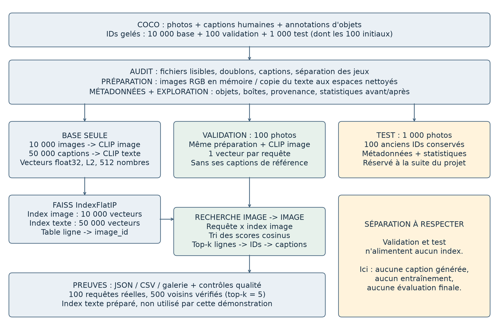
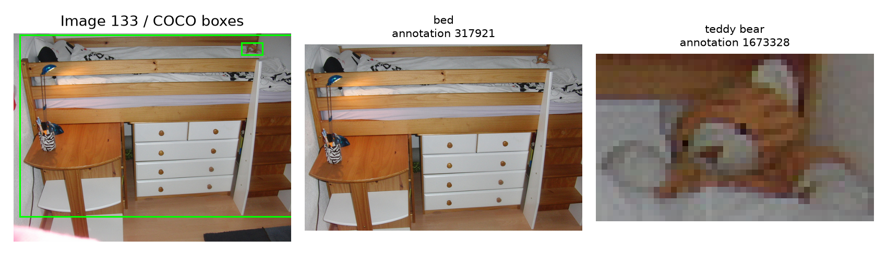
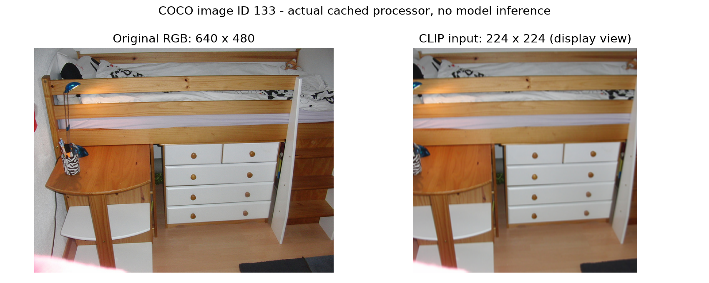
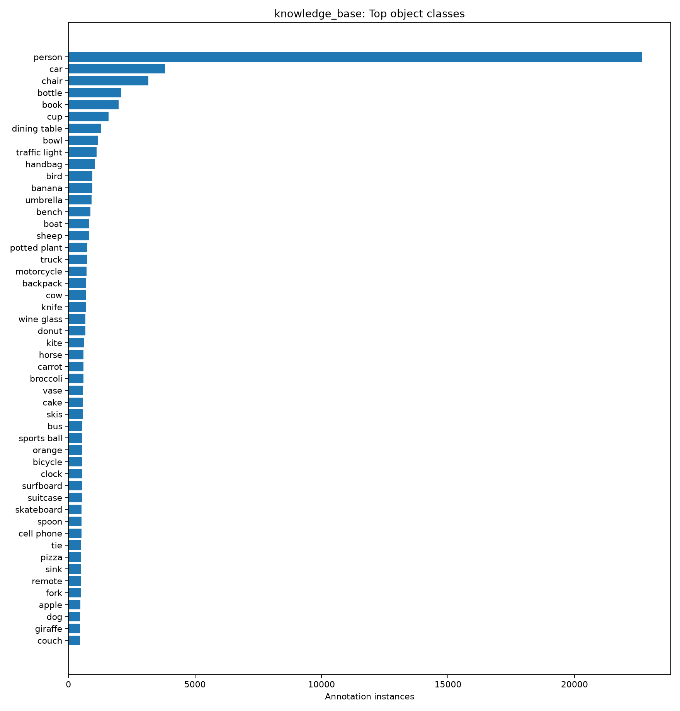
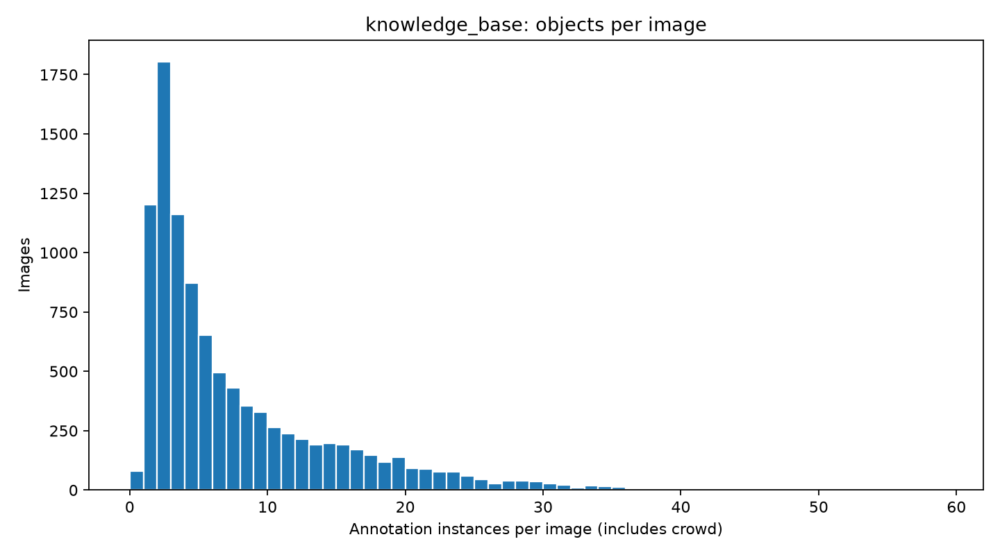
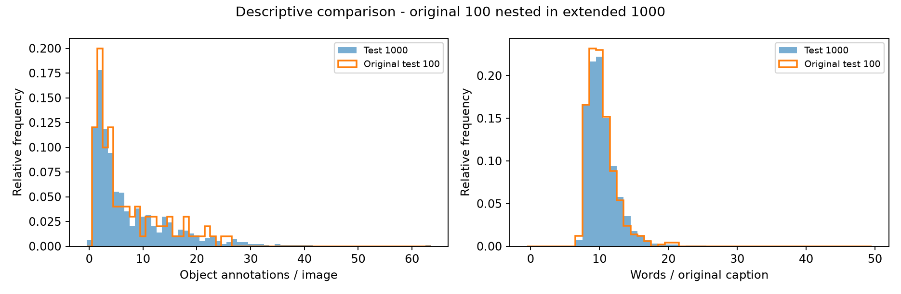
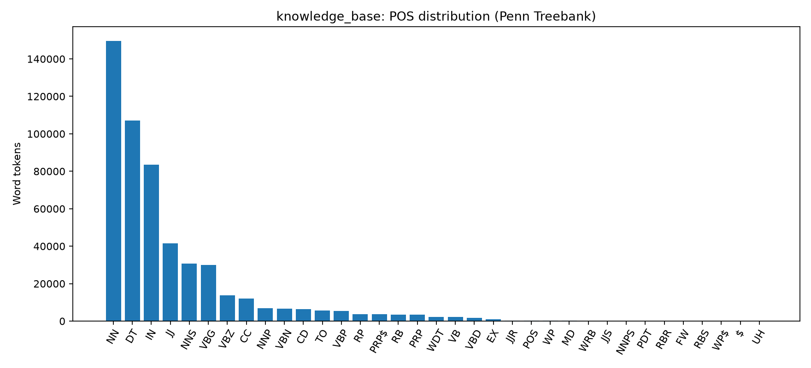
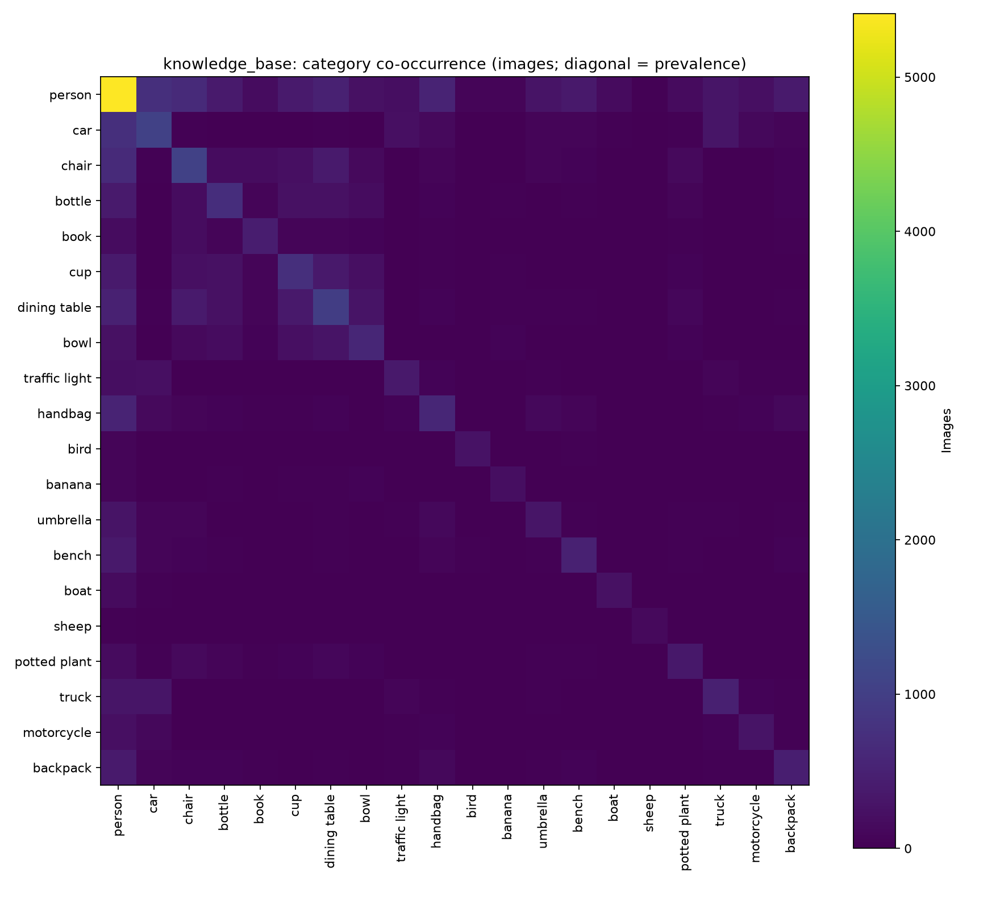
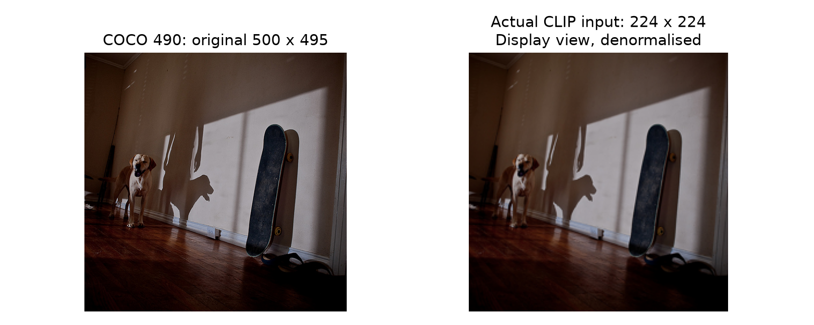
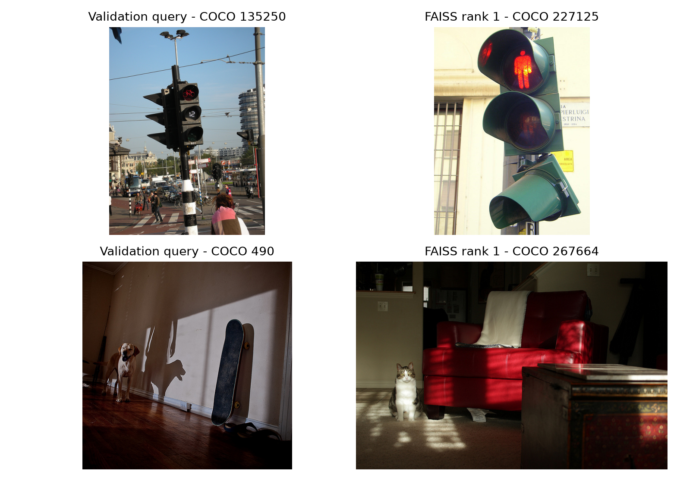

# Exploration et prétraitement des données

République algérienne démocratique et populaire
Ministère de l'Enseignement supérieur et de la Recherche scientifique

Université d'Alger 1 Benyoucef Benkhedda
Faculté des sciences - Département d'informatique


Master 1 - Ingénierie des systèmes informatiques intelligents
Module : Introduction au Traitement d'Images

A comparative study of RAG techniques
for generating image captions

Rapport de phase 1

Exploration et prétraitement des données

Réalisé par

Hamou Yasmine
Ouziala Ali
Lounis Aya

Année universitaire 2026-2027
Échéance de la phase : 4 novembre 2026
Version mise à jour : 7 novembre 2026

## 1. Objectif et guide de lecture

Une caption est une phrase qui décrit une image. Plus tard, le RAG cherchera des exemples proches pour aider un modèle à écrire cette phrase. Avant cela, il faut disposer de données fiables : une image lisible, ses cinq phrases de référence, ses informations associées et une représentation numérique utilisable pour la recherche.

Le mot entraînement désigne ici la partie train2017 utilisée pour constituer la base. CLIP est utilisé avec ses poids préentraînés : nous ne l'avons pas entraîné ni ajusté sur ces images.

| Étape | Question traitée | Page |
|---|---|---|
| Vue d'ensemble | Quel parcours suit une image ? | 3 |
| Choix et données | Pourquoi ces outils et ces jeux ? | 4-5 |
| Audit et préparation | Que vérifie-t-on et que transforme-t-on ? | 6-9 |
| Exploration | Que montrent les statistiques ? | 10-13 |
| CLIP / FAISS | Comment la recherche fonctionne-t-elle ? | 14-15 |
| Exemple et discussion | Suivre une photo et comprendre les erreurs | 16-17 |
| Reproduction | Quelles commandes relancer ? | 18-19 |
| Bilan et limites | Ce qui est prêt et ce qui reste à valider | 20 |

### Comment lire les résultats

Les nombres proviennent des JSON et CSV du projet. Les figures proviennent des images COCO et des statistiques sauvegardées. Chaque étape donne ses fichiers d'entrée, sa méthode et sa sortie. Les termes techniques sont définis au moment où ils apparaissent.

Le code est organisé en modules correspondant aux étapes. La commande python -m src.cli permet de les lancer dans le terminal. Les notebooks appellent ces mêmes modules : ils ne constituent pas une seconde méthode de calcul. Les fichiers de sortie permettent de vérifier les résultats sans refaire tout le calcul.

## 2. Vue d'ensemble : du fichier à la recherche

Le projet prépare une bibliothèque d'exemples. Une nouvelle photo sera comparée à cette bibliothèque : on cherche des images proches, puis on récupère les phrases déjà associées à ces images. Dans cette phase, le programme ne rédige aucune nouvelle phrase.



### Lire le schéma en trois questions

1. Que prépare-t-on ? Les fichiers COCO, leurs objets et leurs cinq captions humaines. L'audit vérifie les données avant de calculer les statistiques et les vecteurs. Les originaux sont conservés.

2. Dans quoi cherche-t-on ? Uniquement dans les 10 000 images de la base. CLIP traduit chaque image en 512 nombres ; FAISS compare ces listes de nombres. Le fichier de correspondance permet ensuite de retrouver la bonne photo et ses captions.

3. Comment le vérifie-t-on ? Les 100 images de validation servent de requêtes, sans leurs captions. Les 1 000 images de test sont préparées et décrites, mais leur évaluation finale attend la phase suivante.

## 3. Pourquoi ces choix ?

Nous avons choisi une chaîne simple à vérifier sur ce PC. Chaque choix répond à un besoin précis ; aucun test présenté ici ne démontre que cette configuration est la meilleure possible.

| Choix | Pourquoi ? | Limite à connaître |
|---|---|---|
| IDs fixes, graine 42 | Retrouver exactement les mêmes images ; conserver le premier test de 100. | Un tirage local ne remplace pas la liste commune de l'enseignante. |
| Objets des annotations COCO | Relier directement chaque catégorie et boîte à son image, avec une source connue. | Ce n'est pas un détecteur exécuté sur les pixels. La boîte invalide est signalée. |
| Nettoyage léger des captions | Corriger les espaces sans changer le sens ; conserver caption_raw pour vérifier. | Les éventuelles erreurs de langage humaines ne sont pas corrigées. |
| Processeur officiel de CLIP | Donner au modèle le format attendu : RGB, 224 x 224 et normalisation identique. | Le recadrage central peut supprimer un objet sur le bord. |
| CLIP préentraîné et figé | Représenter images et textes sans entraîner un modèle sur ce petit jeu. | Une ressemblance globale ne garantit pas les bons objets ou la bonne action. |
| L2 + IndexFlatIP | La norme vaut 1 ; le produit scalaire devient un cosinus. Comparaison exhaustive des 10 000 images. | Simple à contrôler, mais le coût augmente avec la taille de la base. |
| JSONL + image_rows.json | Séparer les vecteurs des textes tout en gardant un lien explicite par image_id. | Un décalage de lignes donnerait de mauvaises captions ; le contrôle vérifie ce lien. |

Pourquoi ne pas chercher directement dans les phrases de validation ? Parce qu'on disposerait alors d'une description de la réponse. La démonstration part uniquement des pixels de la requête. L'index texte est préparé pour la suite ; il n'intervient pas dans ce test image-vers-image.

## 4. Données COCO et séparation des jeux

COCO fournit les photographies et des fichiers JSON. Les fichiers captions associent des phrases aux images. Les fichiers instances associent des catégories d'objets et leurs boîtes englobantes aux images. Le nom du dossier officiel est val2017, et non val17.

| Usage | Source | Présent | Cible |
|---|---|---|---|
| Base de connaissances | train2017 | 10 000 | 10 000 |
| Validation séparée | train2017 | 100 | 100 |
| Premier test conservé | val2017 | 100 | 100 |
| Test étendu | val2017 | 1 000 | 1 000 |

10 000 + 100 = 10 100 images distinctes de train2017. Les 1 000 images de test viennent de val2017 : le total est donc de 11 100 images distinctes. Les 100 images du premier test sont incluses dans les 1 000 ; elles ne s'ajoutent pas une seconde fois.

### Pourquoi séparer les usages ?

La base contient les exemples que FAISS peut retrouver. La validation sert aux vérifications et, plus tard, aux choix de paramètres. Le test doit rester réservé à l'évaluation. Ses phrases de référence ne doivent pas servir à construire une requête ni être ajoutées à la base.

### Comment les images ont été choisies

Les candidates doivent avoir leurs informations d'instances et exactement cinq captions. Les exclusions d'éligibilité sont enregistrées : 315 IDs de train2017 et 13 de val2017. Ce n'est pas un décompte d'images corrompues. Les scènes sont réparties selon le nombre d'annotations : simples (0 à 3), moyennes (4 à 7), complexes (8 ou plus). Les quotas sont proportionnels ; les arrondis sont distribués par la méthode des plus grands restes. Le tirage utilise la graine 42.

La commande extend-test a conservé exactement les IDs de la base et de la validation. Elle a gardé les 100 anciens IDs et ajouté un tirage stratifié de 900 autres IDs éligibles de val2017, avec la graine 42. Les listes sont gelées et vérifiées par SHA256. L'ancienne version est archivée dans reports/releases/. La liste commune de la classe n'ayant pas été fournie, ce test local ne peut pas être présenté comme le test commun officiel.

## 5. Téléchargement et audit des données

Le téléchargement utilise le stockage officiel COCO sur S3, en HTTPS. Seules les photographies des IDs gelés sont téléchargées. L'archive d'annotations est décompressée pour obtenir captions_train2017.json, captions_val2017.json, instances_train2017.json et instances_val2017.json. Les originaux restent dans data/raw/.

Avant toute préparation, le programme vérifie l'existence de chaque fichier, le décodage complet avec Pillow, ses dimensions, ses cinq captions et les identifiants associés. Il calcule des empreintes des fichiers et des pixels RGB pour rechercher des copies exactes. Il vérifie aussi les intersections entre listes d'images et entre IDs de captions.

| Contrôle | Résultat observé |
|---|---|
| Images attendues / présentes / lisibles | 11 100 / 11 100 / 11 100 |
| Images manquantes ou illisibles | 0 |
| Captions par image | 5 |
| IDs d'images communs entre jeux | 0 |
| Copies exactes de fichiers ou pixels | 0 |
| Boîte dégénérée documentée | 1 |
| Textes normalisés partagés entre jeux | 87 |

### Une anomalie conservée et expliquée

L'annotation 918 de l'image 200365 contient la boîte [296.65, 388.33, 1.03, 0.0] : sa hauteur est nulle. L'audit initial s'est arrêté. La décision a été de garder l'image, les phrases et la catégorie d'objet, mais d'indiquer bbox_valid=false. Cette boîte n'entre ni dans les calculs géométriques ni dans le dessin des rectangles. Les fichiers COCO n'ont pas été corrigés manuellement.

L'audit étendu relève 87 textes normalisés partagés entre jeux. Ces phrases appartiennent à des images et des annotations distinctes : ce signal est documenté sans suppression automatique. Les doublons exacts de fichiers et de pixels sont vérifiés ; les quasi-doublons visuels restent une limite. Les preuves sont dans reports/audit.json et reports/tables/.

## 6. Relier les images à leurs métadonnées

Une métadonnée est une information associée à l'image. Ici, chaque ligne JSONL correspond à une image : image_id, nom du fichier, jeu, dimensions, empreinte, cinq captions, objets, catégories et boîtes. JSONL signifie simplement un objet JSON par ligne. Cela permet de retrouver une image sans perdre les informations qui lui appartiennent.

| Information | Source réelle | Interprétation |
|---|---|---|
| Objets et boîtes | coco_annotation | Annotations humaines COCO |
| Couleurs, formes, contexte | caption_heuristic | Mots repérés dans les captions |
| Relations spatiales | bbox_heuristic | Calcul géométrique sur les boîtes |



### Détection visuelle et confiance : ce qui a été fait

Aucun YOLO, DETR ou autre détecteur n'a été exécuté. L'extraction visuelle recommandée par l'enseignante reste donc une amélioration possible. CLIP fournit un vecteur global ; il ne fournit pas ici une liste d'objets avec des boîtes et des scores. Les statistiques d'objets actuelles portent sur les annotations COCO.

Chaque caption humaine porte maintenant source=coco_human_reference et confidence=1. Le seuil de conservation des références est également fixé à 1 dans la configuration et dans la politique des métadonnées : les cinq références humaines sont donc gardées. Cette valeur est une convention de provenance, pas une probabilité calibrée. Elle n'est attribuée ni aux attributs repérés par lexique ni aux relations déduites. Aucun seuil de détecteur visuel ne s'applique, puisqu'aucun détecteur n'a été exécuté.

## 7. Prétraitement des images

Le prétraitement prépare le format attendu par CLIP. On ouvre le JPEG, on corrige son orientation EXIF si nécessaire, puis on le convertit en RGB. RGB conserve les trois canaux de couleur attendus par l'encodeur. Nous gardons cette information de couleur pour représenter le contenu des photographies.

Le processeur officiel du modèle redimensionne le petit côté à 224 pixels en conservant le rapport largeur/hauteur, puis réalise un recadrage central de 224 x 224. Il met les valeurs à l'échelle puis normalise chaque canal selon les paramètres du modèle. Ce recadrage peut retirer des objets en bordure : c'est une limite à garder en tête.



```powershell
mean = [0.48145466, 0.45782750, 0.40821073]
std  = [0.26862954, 0.26130258, 0.27577711]
normalised_channel = (channel / 255 - mean) / std
```

Le contrôle illustré a produit un tenseur fini de forme (1, 3, 224, 224). L'empreinte du JPEG est identique avant et après. Les images transformées sont utilisées en mémoire ; aucun second lot de JPEG n'est écrit dans data/processed/. L'exemple et ses paramètres sont enregistrés dans reports/phase1_processor_example.json.

## 8. Captions et comparaison avant/après

Les captions originales sont les références humaines. Le champ caption_raw conserve leur texte exact, y compris les espaces. Un champ séparé, caption_clean, sert à l'indexation : les espaces multiples et ceux en début ou fin de phrase sont normalisés. La casse et la ponctuation sont conservées avec la configuration actuelle. Il n'y a ni traduction, ni réécriture, ni suppression des mots fréquents.

| Jeu | Images avant/après | Captions | Champs nettoyés modifiés |
|---|---|---|---|
| knowledge_base | 10000 / 10000 | 50000 | 7743 |
| validation | 100 / 100 | 500 | 72 |
| test | 1000 / 1000 | 5000 | 745 |
| test_100 | 100 / 100 | 500 | 88 |

Dans la base, 7743 captions sur 50 000 ont un champ nettoyé différent du texte brut. Le nombre de caractères passe de 2620933 à 2612839. Les 50 000 références brutes restent inchangées. Ces valeurs ont été recomptées sur les métadonnées réelles lors de la revue.

```powershell
caption_id: 424250
raw:   'Bunk bed with a narrow shelf sitting underneath it. '
clean: 'Bunk bed with a narrow shelf sitting underneath it.'
```

### Ce que compare cette exploration

Avant/après désigne ici la conservation des effectifs, le nettoyage du texte, les formats d'image et l'exclusion géométrique de la boîte invalide. Les 72 507 annotations d'objets de la base restent présentes ; 72 506 boîtes sont utilisables pour les relations. La distribution des catégories ne change donc pas. Nous ne prétendons pas avoir amélioré un score de génération.

Les statistiques linguistiques des pages suivantes utilisent le texte brut. Le tokenizer NLTK Treebank découpe les phrases ; seuls les tokens contenant une lettre sont comptés comme mots. Ils passent en minuscules pour le vocabulaire. Pour les catégories grammaticales (POS), le modèle reçoit la séquence complète avec sa casse d'origine. Une mesure en mots n'est pas le nombre de sous-tokens utilisé par CLIP.

## 9. Exploration : fréquence des objets

La base contient 72 507 annotations d'objets. Le graphique compte les occurrences d'annotations, pas le nombre d'images contenant chaque catégorie. Une image avec plusieurs personnes contribue plusieurs fois à person. Les annotations de foule restent comptées comme des entrées d'annotation.



La catégorie person domine avec 22 670 annotations, devant car (3 815) et chair (3 151). Ce déséquilibre décrit notre sous-ensemble. Il ne permet pas, à lui seul, de conclure à la qualité d'un futur modèle.

## 10. Exploration : complexité des scènes

| Mesure | Base | Validation | Test 100 | Test 1000 |
|---|---|---|---|---|
| Annotations/image : moyenne | 7.2507 | 7.3400 | 7.0500 | 7.3880 |
| Médiane | 4.0 | 4.5 | 4.0 | 4.0 |
| Écart-type | 7.3305 | 8.3848 | 6.4628 | 7.4213 |
| Minimum - maximum | 0 - 59 | 0 - 58 | 1 - 26 | 0 - 63 |





La base comprend 4 247 scènes simples, 2 449 moyennes et 3 304 complexes selon les seuils de comptage choisis. Ces catégories ne sont pas des labels officiels de COCO. La moyenne supérieure à la médiane signale des scènes très chargées. Le test de 100 images étant inclus dans celui de 1 000, les deux échantillons ne sont pas indépendants. La comparaison décrit les données ; elle ne mesure pas une performance du RAG.

## 11. Exploration : texte et vocabulaire

| Mesure | Base | Validation | Test 100 | Test 1000 |
|---|---|---|---|---|
| Captions | 50000 | 500 | 500 | 5000 |
| Mots/caption : moyenne | 10.4525 | 10.2900 | 10.2720 | 10.4490 |
| Médiane | 10.0 | 10.0 | 10.0 | 10.0 |
| Minimum - maximum | 6-49 | 7-32 | 7-21 | 7-49 |
| Vocabulaire distinct | 9972 | 945 | 904 | 3372 |
| Mots au total | 522625 | 5145 | 5136 | 52245 |



NN correspond aux noms communs singuliers (149 690 tokens), DT aux déterminants (107 020), IN aux prépositions ou conjonctions de subordination (83 586), JJ aux adjectifs (41 620) et VBG aux formes en -ing (29 990). Il s'agit de prédictions du tagger anglais NLTK, pas d'étiquettes grammaticales vérifiées à la main.

Le vocabulaire de la base est plus grand en partie parce qu'elle contient cent fois plus de captions. Comparer directement 9 972 et 945 ne démontre donc pas une meilleure diversité. Les histogrammes de longueur, fréquences des mots et tables POS sont également sauvegardés pour chaque jeu dans reports/figures/ et reports/tables/.

## 12. Cooccurrences, relations et diversité



La cooccurrence travaille sur la présence d'une catégorie par image : dix personnes dans une photo ne valent qu'une présence de person. Elle ne mesure pas une interaction, par exemple tenir ou conduire. Les relations left_of et above comparent les centres des boîtes ; overlap utilise une intersection sur union (IoU) d'au moins 0,1. Il y a 495 256 paires orientées left_of et 45 020 paires overlap dans la base. Les directions inverses se répondent ; il ne faut pas additionner ces comptes comme des relations indépendantes.

Pour la diversité, un petit lexique cherche les mots de couleur, de forme et de contexte dans les cinq captions d'une image. white apparaît dans 1 997 images, red dans 870, night dans 136 et round dans 61. Ce sont des mentions textuelles : white ne dit pas quel objet est blanc et l'absence de night ne signifie pas day. Le mot on n'est pas une relation visuelle vérifiée.

44 figures décrivent les quatre vues : base, validation, test de 1 000 images et sous-ensemble historique de 100 images. La figure comparative supplémentaire facilite la lecture des deux tests. Les statistiques des objets proviennent des annotations COCO ; celles d'un éventuel détecteur devront être calculées séparément sur ses sorties réelles.

## 13. Embeddings CLIP et index FAISS

Un embedding est une liste de nombres représentant le contenu d'une image ou d'un texte. CLIP fournit ici 512 nombres pour chaque image et chaque caption. Des contenus proches peuvent recevoir des vecteurs proches. CLIP est figé en mode inférence ; il ne rédige pas de captions dans cette phase.

```powershell
Model: openai/clip-vit-base-patch32
Revision: 3d74acf9a28c67741b2f4f2ea7635f0aaf6f0268
Device: CPU | batch: 32 | dtype: float32 | L2 normalisation
```

| Artefact | Forme / nombre | Fichier |
|---|---|---|
| Vecteurs image | 10 000 x 512 | artifacts/embeddings/image.npy |
| Vecteurs texte | 50 000 x 512 | artifacts/embeddings/text.npy |
| Index image | 10 000 | artifacts/indexes/image.index |
| Index texte | 50 000 | artifacts/indexes/text.index |

Les vecteurs sont divisés par leur norme L2 pour avoir une longueur de 1. FAISS utilise IndexFlatIP : il compare la requête à tous les vecteurs de l'index par produit scalaire. Sur ces vecteurs normalisés, ce produit est la similarité cosinus. L'index est exact pour les vecteurs fournis ; il ne garantit pas que le voisin représente le même objet.

| Index | Construction enregistrée | Taille disque |
|---|---|---|
| image | 0.0075 s | 20480045 |
| text | 0.0340 s | 102400045 |

Les fichiers image_rows.json et text_rows.json assurent la correspondance entre position du vecteur, image_id et caption_id. Les métadonnées contiennent ensuite les phrases et objets. Les contrôles reconstruisent les vecteurs FAISS et les comparent aux matrices sauvegardées. Seuls les 10 000 IDs de la base alimentent les deux index.

Les matrices sont complètes, finies et normalisées, avec des IDs de lignes uniques ; aucune caption n'a été tronquée par CLIP. Lors de l'extension du test et de l'ajout des champs de confiance, les véritables entrées de l'encodeur ont été comparées à l'ancienne version : les images et textes de la base sont identiques. Les fichiers .npy ont donc été conservés, empreintes inchangées, et les index ont été reconstruits. Cette migration vérifiée est enregistrée dans reports/phase1_upgrade.json ; aucun nouvel entraînement n'a été réalisé.

## 14. Vérifier la recherche d'images proches

Pour chacune des 100 images de validation, la photographie seule est prétraitée puis encodée par CLIP. Son vecteur interroge l'index image de la base. Le programme récupère les cinq voisins, leurs IDs, leurs scores et leurs captions de référence. Les phrases de validation n'interviennent pas dans la requête.


| Rang | COCO image ID | Similarité cosinus |
|---|---|---|
| 1 | 267664 | 0.818381 |
| 2 | 545323 | 0.801236 |
| 3 | 127643 | 0.790362 |
| 4 | 516396 | 0.778416 |
| 5 | 81686 | 0.772747 |

Les 100 requêtes ont produit 500 voisins sauvegardés en JSON et CSV. Le temps enregistré d'encodage des lots est 7.982 s ; la recherche moyenne par requête est 4.167 ms sur cette machine. Ce sont des observations fonctionnelles, pas un benchmark matériel contrôlé. Les 500 résultats ont été rejoués contre FAISS lors de la revue.

Un score de 0,818 ne signifie pas 81,8 % de probabilité d'une caption correcte. Sans labels de pertinence ni captions générées, nous ne calculons ici ni Recall@k, ni CIDEr, ni BLEU. La proximité visuelle peut être imparfaite ; le test vérifie le fonctionnement et la traçabilité de la recherche.

## 15. Exemple pas à pas : l'image COCO 490



### 1. Partir d'une photo identifiable

Le fichier data/raw/train2017/000000000490.jpg mesure 500 x 495 pixels. Son ID COCO est 490 : il appartient aux 100 images de validation et n'apparaît pas dans l'index. Les annotations décrivent un chien et un skateboard ; elles servent ici à expliquer la scène, pas à créer la requête.

### 2. Passer des pixels à une liste de nombres

Après conversion RGB, redimensionnement, recadrage et normalisation, le tenseur a la forme 1 x 3 x 224 x 224 : une image, trois canaux de couleur. CLIP le transforme en 512 nombres. Le vecteur est divisé par sa norme pour obtenir une norme de 1.

```powershell
q[:6] = [-0.004754, 0.019724, -0.012203, 0.059688, -0.002076, -0.001087]
shape(q) = (512,)    norm(q) = 1.000000
```

### 3. Comparer, trier, retrouver l'image

Pour chaque vecteur de la base, FAISS multiplie les nombres correspondants et additionne les 512 produits : score = somme(q[j] x v[j]). Les cinq scores les plus grands sont retenus. Le premier vaut 0,818381 et pointe vers la ligne 4450, comptée à partir de zéro.

```powershell
image_rows[4450]['image_id'] = 267664
FAISS score = 0.818381071
Direct dot product = 0.818381071
```

### 4. Relier le résultat aux captions, puis le vérifier

L'ID 267664 mène à sa ligne de métadonnées et à ses cinq captions. L'une dit : « A lone cat sits in a dark room with some furniture. » Ce texte appartient bien au voisin : il ne décrit pas automatiquement notre chien. La recherche fonctionne, mais ce premier voisin constitue une erreur de catégorie. La confiance 1 de cette référence humaine ne rend pas le score FAISS certain.

Preuve reproductible : reports/pedagogical_example.json contient le vecteur sauvegardé (six premières valeurs), sa norme et le recalcul des cinq scores. La galerie et les cinq voisins complets figurent dans reports/retrieval/manual_490_k5/.

## 16. Comprendre les réussites et les erreurs



### Ce qui réussit : la chaîne est vérifiable

Les 11 100 fichiers sont lisibles, les jeux sont séparés et chaque vecteur mène à la bonne image et à ses vraies captions. Les 500 voisins des 100 requêtes ont été rejoués. C'est une réussite de préparation et de traçabilité ; cela ne mesure pas encore la qualité d'un futur générateur de captions.

### Ce qui réussit parfois : retrouver le même type de contenu

Pour la requête 135250, le premier voisin 227125 montre également un feu de circulation (score 0,838155). L'objet principal concorde, mais le cadrage et l'environnement diffèrent. Ce cas illustre une recherche utile sans prouver que toutes les requêtes sont aussi bonnes.

### Ce qui échoue : ressemblance ne veut pas dire même scène

Pour 490, le premier voisin contient un chat au lieu d'un chien. Les voisins de rangs 3 et 4 montrent un chien et un skateboard : ils reprennent davantage les objets de la requête, sans garantir la même action. La pièce sombre et les formes générales peuvent expliquer le premier résultat ; c'est une hypothèse de lecture visuelle, pas une explication mesurée du modèle.

Ces deux cas ont été choisis pour expliquer le fonctionnement. Ils ne constituent ni un taux de réussite ni une évaluation finale. Les références de validation ont été consultées après la recherche pour commenter les images. Les limites connues restent documentées : boîte invalide isolée, doublons textuels, objets hors recadrage et attributs heuristiques. Les corriger ou comparer plusieurs méthodes demandera un protocole séparé.

## 17. Reproduire : installer et préparer

Dans VS Code, ouvrir le dossier du projet puis Terminal > New Terminal. Ces commandes PowerShell reproduisent la version actuelle : 10 000 images de base, 100 de validation distinctes et 1 000 de test, dont les 100 premières restent identifiables. Les IDs sont déjà fournis : ne pas refaire le tirage. Exécuter les commandes une par une et s'arrêter si une commande échoue.

### A. Sur un nouveau PC, après téléchargement du code

Installer Python 3.12 x64 puis créer l'environnement. L'exécution historique a utilisé Python 3.12.10 et des bibliothèques présentes sur ce PC ; ce n'était pas une installation isolée. Les versions exactes sont enregistrées dans les manifestes. Une installation propre sur une autre machine doit être vérifiée séparément.

```powershell
py -3.12 -m venv imp
.\imp\Scripts\python.exe -m pip install -r requirements.txt
$impPython = ".\imp\Scripts\python.exe"
```

### B. Récupérer les entrées nécessaires

```powershell
& $impPython -m src.cli download-annotations
& $impPython -m src.cli download-images
& $impPython -m src.cli download-nlp
& $impPython -m src.cli download-model
& $impPython -m src.cli audit
```

Réutiliser les listes artifacts/splits/ fournies avec le projet. Ne pas relancer splits --force pour une simple reproduction. download-images utilise ces IDs et ignore les fichiers déjà présents ; audit doit signaler toute image illisible. download-model charge les poids CLIP à la révision fixée, tandis que download-nlp récupère le modèle grammatical anglais.

### C. Préparer les métadonnées et les statistiques

```powershell
& $impPython -m src.cli metadata
& $impPython -m src.cli eda
```

Sorties attendues : trois JSONL et un manifeste dans artifacts/metadata/, reports/eda.json, ainsi que les figures et tables. Les originaux data/raw/ restent inchangés. Dans le projet déjà préparé, ces étapes n'ont pas besoin d'être répétées pour une démonstration de recherche.

## 18. Reproduire : indexer et tester soi-même

### D. Calculer puis contrôler les artefacts

```powershell
$impPython = ".\imp\Scripts\python.exe"
& $impPython -m src.cli --offline embeddings
& $impPython -m src.cli index
& $impPython -m src.cli --offline validate-retrieval --top-k 5
& $impPython -m src.cli --offline qc
& $impPython -m src.cli report
```

Le calcul CLIP est l'étape coûteuse sur CPU. Si les matrices et leurs empreintes sont valides, embeddings les réutilise. Les checkpoints permettent de reprendre un calcul incomplet. qc vérifie les données, les références, les correspondances, les valeurs des vecteurs et les résultats sauvegardés. report produit le résumé technique d'exécution.

### E. Choisir une image et le nombre de voisins

```powershell
& $impPython -m src.cli --offline retrieve `
    --image-id 490 --top-k 5 --show
& $impPython -m src.cli --offline retrieve `
    --image-id 133 --top-k 10 --show
& $impPython -m src.cli --offline retrieve `
    --image-path "C:\photos\ma_photo.jpg" --top-k 5 --show
```

Remplacer le chemin de la dernière commande par un fichier qui existe. Les IDs COCO ne sont pas des numéros de ligne : ID 133 correspond au fichier 000000000133.jpg. Un ID choisi au hasard peut être absent des annotations ou du sous-ensemble téléchargé. Pour voir les photos, ouvrir data/raw/train2017/ en affichage grandes icônes. La photo de validation 490 est un exemple disponible.

Chaque recherche écrit results.json, results.csv, gallery.html et nearest_images.png dans reports/retrieval/. Une image de la base utilisée comme requête est exclue de ses propres résultats. Le dossier Projet_ITI_Drive_v2 contient le code et les données préparées dans trois ZIP : restaurer_donnees.py les remet aux bons chemins. Installer ensuite Python et les bibliothèques une fois, selon son README ; les embeddings ne sont pas recalculés.

```powershell
& $impPython scripts/review_phase1.py
& $impPython scripts/build_phase1_report.py
```

La dernière commande reconstruit ce rapport avec reportlab et pypdf, installables dans tmp/report_deps comme indiqué en tête du script. Ces deux bibliothèques servent uniquement au rapport.

## 19. Bilan, limites et éléments à compléter

La préparation fournit maintenant 10 000 images de base, 100 de validation distinctes et 1 000 de test, soit 11 100 images uniques. Le premier test de 100 est conservé dans le test étendu et analysé séparément. Les références humaines portent la convention de confiance à 1. Les métadonnées, statistiques, vecteurs et index ont été contrôlés sur les données réelles.

### Décisions, limites et validation

1. La cible de 1 000 images est atteinte sans modifier les IDs de la base ou de la validation. Les anciennes données et preuves sont archivées. Le test est un échantillon local stratifié : sa conformité à une liste commune de la classe ne peut pas être certifiée tant que cette liste n'est pas fournie. L'enseignante doit valider la préparation.

2. La méthode retenue utilise les annotations COCO et conserve la source de chaque champ. La détection dans les pixels reste une option recommandée, non exécutée ici. Les couleurs et contextes issus des captions restent heuristiques. La confiance 1 des références humaines ne leur est pas transférée.

3. Faire valider la préparation par l'enseignante. Aucune configuration optimale n'est démontrée par le seul test fonctionnel. Les labels de contexte sont heuristiques ; les annotations de foule ne donnent pas un recensement exact ; le recadrage peut perdre du contenu. La comparaison de performances entre tests 100 et 1 000 attendra une évaluation définie dans la phase suivante.

### Sources et preuves à consulter

[1] Cahier des charges officiel : docs/project/Image processing mini-project english version.pdf, sections 4.1-4.4 et 8. [2] Précisions transmises par l'étudiant : docs/project/teacher_clarifications_20261107.md. [3] Méthode exécutée : src/data/, src/preprocessing/, src/exploration/, src/embeddings/ et src/indexing/.

[4] Effectifs et anomalies : reports/audit.json. [5] Statistiques et tableaux : reports/eda.json et reports/tables/. [6] Modèle, dimensions et index : artifacts/embeddings/manifest.json et artifacts/indexes/manifest.json. [7] Recherche : reports/retrieval/validation/results.json. [8] Vérification actuelle : reports/quality_control.json et reports/phase1_review_20261107.json.

Sources publiques des composants : COCO (cocodataset.org), modèle openai/clip-vit-base-patch32 sur Hugging Face et bibliothèque FAISS (github.com/facebookresearch/faiss). Les chiffres de ce rapport proviennent exclusivement des artefacts locaux décrits ci-dessus.
